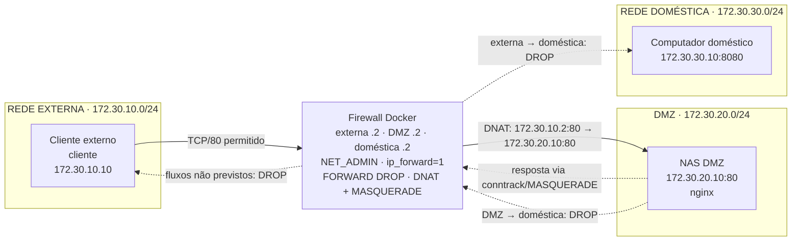

# NAS pessoal com firewall em Docker

Projeto didático de segmentação de rede usando Docker Compose, três redes bridge e um container Alpine atuando como firewall. O tráfego HTTP publicado na rede externa é encaminhado para um NAS localizado na DMZ; o acesso às redes domésticas permanece bloqueado.

> **Aviso didático:** este laboratório ilustra conceitos de roteamento, DNAT, SNAT/MASQUERADE e filtragem com iptables. Não deve ser usado como firewall de produção. As redes são isoladas apenas dentro do ambiente Docker e as imagens, regras e serviços precisam de revisão antes de qualquer uso real.

## 1. Objetivo

Demonstrar uma topologia simples em que:

- um cliente externo acessa o serviço HTTP do NAS por meio do firewall;
- o NAS fica em uma rede DMZ separada;
- um computador pessoal fica em uma rede doméstica sem acesso vindo da rede externa ou da DMZ;
- o firewall encaminha somente a publicação TCP/80 prevista e registra descartes de encaminhamento;
- as regras podem ser inspecionadas diretamente dentro do container `firewall`.

## 2. Cenário e problema

O cenário representa um NAS que precisa ser acessível por HTTP a partir de uma rede externa, mas não deve expor o computador pessoal da rede doméstica. O problema de segurança é evitar que a publicação do NAS transforme toda a rede interna em uma rede alcançável.

A solução separa os papéis em redes distintas:

| Segmento | Sub-rede | Participantes | Finalidade |
|---|---|---|---|
| `externa` | `172.30.10.0/24` | firewall `172.30.10.2`, cliente `172.30.10.10` | origem do acesso publicado |
| `dmz` | `172.30.20.0/24` | firewall `172.30.20.2`, NAS `172.30.20.10` | serviço HTTP publicado |
| `domestica` | `172.30.30.0/24` | firewall `172.30.30.2`, computador `172.30.30.10` | rede que não deve ser alcançada |

## 3. Arquitetura e fluxo

O serviço `firewall` possui uma interface em cada rede, recebe `NET_ADMIN` e tem `net.ipv4.ip_forward=1`. O cliente recebe `NET_ADMIN` somente como capacidade de laboratório necessária para instalar rotas estáticas e forçar o tráfego para outras redes via `172.30.10.2`. O NAS recebe `NET_ADMIN` para instalar a rota `172.30.30.0/24 via 172.30.20.2` antes de iniciar o nginx. O computador pessoal mantém um listener TCP/8080 para permitir os testes de bloqueio.

O acesso HTTP segue este fluxo:

1. `cliente` conecta em `172.30.10.2:80`.
2. O firewall aplica DNAT para `172.30.20.10:80`.
3. A regra de `FORWARD` permite a nova conexão da rede externa para o NAS.
4. `MASQUERADE` no tráfego destinado ao NAS faz o retorno passar pelo firewall; o conntrack desfaz o DNAT na resposta.

O tráfego novo da rede externa ou da DMZ para `172.30.30.0/24` é explicitamente descartado. A política padrão de `FORWARD` também é `DROP`, portanto fluxos não previstos não são liberados por acidente.

### Diagrama Mermaid



O firewall é o único serviço conectado às três redes. As linhas contínuas representam o fluxo permitido; as tracejadas representam tentativas bloqueadas ou o retorno que deve atravessar o firewall. O acesso autorizado é somente TCP/80 para o NAS. O computador doméstico não recebe conexões novas da rede externa nem da DMZ.

## 4. Containers, imagens e redes

- **`firewall`** — construído em `firewall/Dockerfile` a partir de `alpine:3.20`; instala `iproute2` e `iptables`; executa `firewall/entrypoint.sh`.
- **`cliente`** — construído em `cliente/Dockerfile`; instala `curl`, `iproute2`, `iptables` e `netcat-openbsd`; instala rotas para DMZ e rede doméstica via `172.30.10.2`. Recebe `NET_ADMIN` exclusivamente para essa configuração de laboratório.
- **`nas`** — construído em `nas/Dockerfile` a partir de `nginx:1.27-alpine`; instala `iproute2` e `netcat-openbsd`, configura a rota doméstica e publica `nas/index.html` como `ro`.
- **`computador-pessoal`** — construído em `computador-pessoal/Dockerfile`; instala `netcat-openbsd` e escuta TCP/8080.

O firewall é o único container conectado às três redes. Os demais participam de apenas uma rede cada, conforme definido em `compose.yaml`.

### Estrutura do projeto

```text
.
├── compose.yaml
├── firewall/
│   ├── Dockerfile
│   └── entrypoint.sh
├── cliente/
│   ├── Dockerfile
│   └── entrypoint.sh
├── nas/
│   ├── Dockerfile
│   ├── entrypoint.sh
│   └── index.html
├── computador-pessoal/Dockerfile
├── tests/validar.sh
├── docs/topologia.mmd
└── docs/relatorio.md
```

Não há portas Docker publicadas no host no `compose.yaml`. O cliente acessa o endereço do firewall dentro da rede `externa`; a exposição para o NAS é feita por DNAT, no namespace de rede do firewall. **Porta publicada** (`ports: "HOST:CONTAINER"`) cria um encaminhamento do host Docker para um container e pode envolver regras próprias do Docker. **DNAT** altera o destino de um pacote que atravessa o firewall (`172.30.10.2:80` para `172.30.20.10:80`) e só funciona como previsto quando o tráfego realmente passa por suas interfaces e regras. São mecanismos diferentes e não devem ser descritos como equivalentes.

## 5. Pré-requisitos

- Docker Engine ou Docker Desktop em execução;
- suporte ao comando `docker compose` (Compose v2);
- acesso à Internet na primeira construção, para baixar imagens e pacotes Alpine;
- shell compatível com `sh` para executar `tests/validar.sh` (Linux, WSL ou ambiente equivalente). No PowerShell, os comandos Docker individuais podem ser executados normalmente, mas o script `.sh` requer um shell Unix;
- privilégios suficientes para executar containers com `NET_ADMIN` no firewall, no cliente e no NAS. No cliente, essa capacidade não representa um requisito de produção: é o mecanismo explícito usado neste laboratório para impedir a dependência do gateway Docker.

Não é necessário instalar nginx, iptables ou netcat no host: eles são fornecidos pelos containers.

## 6. Execução

A partir da raiz do projeto:

```sh
docker compose config -q
docker compose up -d --build
docker compose ps
```

Teste manual do caminho permitido:

```sh
docker compose exec -T cliente curl --fail --silent --show-error http://172.30.10.2/
```

O retorno esperado contém `NAS acessível pela DMZ`.

Ao terminar:

```sh
docker compose down -v --remove-orphans
```

### Comandos Git sugeridos

Para revisar e compartilhar as alterações sem misturá-las com outros arquivos:

```sh
git status
git diff -- README.md docs/relatorio.md
git add README.md docs/relatorio.md
git diff --cached --check
git diff --cached
```

Depois da revisão, o responsável pelo repositório pode criar o commit conforme a política do projeto, por exemplo `git commit -m "docs: documentar topologia e validação do firewall"`. O commit não é necessário para executar o laboratório e não faz parte desta atualização.

## 7. Testes positivos e negativos

### Testes previstos

| Caso | Comando/fluxo | Resultado esperado |
|---|---|---|
| Positivo: HTTP externo → NAS | `curl http://172.30.10.2/` no `cliente` | sucesso HTTP e corpo contendo `NAS acessível pela DMZ` |
| Negativo: externa → computador | conexão TCP para `172.30.30.10:8080` a partir do `cliente` | falha/timeout; não deve alcançar o listener |
| Negativo: NAS → computador | conexão TCP para `172.30.30.10:8080` a partir do `nas` | falha/timeout; não deve alcançar o listener |
| Inspeção | `iptables -S` e `iptables -t nat -S` no firewall | políticas e regras de DNAT/MASQUERADE presentes |

### Estado do teste automatizado existente

O arquivo `tests/validar.sh` executa os casos acima e verifica também os estados `running`, a existência de `nc`, as rotas, a porta não publicada 81 e as tabelas `filter` e `nat`.

O cliente instala explicitamente `172.30.20.0/24 via 172.30.10.2` e `172.30.30.0/24 via 172.30.10.2` no entrypoint. Isso é deliberado: sem `NET_ADMIN`, ele dependeria do gateway Docker e poderia alcançar outras redes sem passar pela política do firewall. O NAS instala a rota doméstica via `172.30.20.2`. O teste confirma as rotas com `ip route get`, além de inspecionar a política `INPUT DROP` para que a verificação da porta 81 não dependa da ausência de um serviço.

Assim, os resultados acima são **comportamentos esperados pela configuração**, não resultados efetivamente testados neste documento. Para transformá-los em evidência, execute `tests/validar.sh` em um ambiente Docker disponível e preserve sua saída. Uma verificação manual equivalente para NAT é:

```sh
docker compose exec -T firewall iptables -t nat -S
```

## 8. Inspeção do iptables

Listar políticas e regras de filtragem:

```sh
docker compose exec -T firewall iptables -S
docker compose exec -T firewall iptables -L -n -v
```

Listar regras NAT:

```sh
docker compose exec -T firewall iptables -t nat -S
docker compose exec -T firewall iptables -t nat -L -n -v
```

Consultar interfaces e encaminhamento:

```sh
docker compose exec -T firewall ip -4 addr
docker compose exec -T firewall ip route
docker compose exec -T firewall cat /proc/sys/net/ipv4/ip_forward
```

O valor esperado de `ip_forward` é `1`. As interfaces são identificadas pelo script a partir dos endereços `172.30.10.2/24`, `172.30.20.2/24` e `172.30.30.2/24`, portanto os nomes podem variar entre execuções.

## 9. Regras implementadas

Em `firewall/entrypoint.sh`:

- limpa tabelas filter e nat;
- define `INPUT DROP`, `FORWARD DROP` e `OUTPUT ACCEPT`;
- permite loopback e conexões `ESTABLISHED,RELATED` em `INPUT`;
- permite conexões `ESTABLISHED,RELATED` em `FORWARD`;
- faz DNAT de TCP/80 recebido pela interface externa para `172.30.20.10:80`;
- permite somente o novo encaminhamento externo → DMZ destinado ao NAS na porta 80;
- bloqueia explicitamente DMZ → doméstica e externa → doméstica;
- aplica `MASQUERADE` ao fluxo externo destinado ao NAS;
- registra descartes de `FORWARD` com limite de cinco por minuto e burst de dez.

## 10. Limitações e segurança

- O serviço publicado é apenas HTTP, sem TLS, autenticação ou controle de aplicação.
- `OUTPUT ACCEPT` é permissivo para tráfego originado no firewall.
- Não há regra de `INPUT` para administração remota; isso é coerente com o laboratório, mas limita diagnósticos pelo próprio firewall.
- As regras são recriadas no início do container e não são persistidas fora dele.
- `firewall`, `cliente` e `nas` possuem `NET_ADMIN`; no cliente, a capacidade é uma concessão explícita de laboratório para instalar as rotas que obrigam o caminho via firewall. Removê-la reintroduziria a dependência do gateway Docker.
- O endereçamento é fixo e pode conflitar com redes existentes no host.
- O listener do computador pessoal existe apenas para teste e não representa um serviço real.
- Não há observabilidade persistente, TLS, IPv6, rate limiting abrangente, IDS/IPS ou hardening das imagens além do que as imagens base oferecem.
- O tráfego do cliente para DMZ e doméstica é encaminhado por rotas explícitas via `172.30.10.2`; o teste valida ambos os destinos. A porta 81 é validada principalmente pela política `INPUT DROP`, pois uma conexão recusada isoladamente não prova que um serviço inexistente foi filtrado.

## 11. Troubleshooting

### `docker compose` não inicia

Execute `docker compose config -q` e confirme que o Docker Engine está em execução. Verifique também se as sub-redes `172.30.10.0/24`, `172.30.20.0/24` e `172.30.30.0/24` não estão em conflito.

#### Conflito de sub-rede

O Compose não consegue criar uma bridge quando uma dessas faixas já é usada por outra rede Docker, VPN, rede corporativa ou rota do host. Liste as redes e suas sub-redes com `docker network ls` e `docker network inspect <nome-da-rede>`. Desconecte/remova somente uma rede de laboratório que não esteja em uso (`docker network rm <nome>`), ou altere de forma consistente as três sub-redes, os IPs fixos, as rotas dos entrypoints, as regras do firewall e os testes. Não “corrija” o conflito publicando portas: isso não substitui o roteamento entre as três redes.

No ambiente atual, esse conflito impede a execução Docker completa; portanto, a validação integral ainda depende do avaliador ou de um ambiente Docker sem sobreposição de sub-redes. Os comandos e resultados descritos neste README são procedimento e comportamento esperado, não evidência de uma execução já realizada.

### O firewall não sobe

Veja os logs:

```sh
docker compose logs firewall
```

O entrypoint falha se não encontrar as três interfaces com os IPs esperados. Confira `docker compose ps` e `docker compose exec firewall ip -4 addr`.

### O `curl` falha

Confirme que todos os serviços estão em execução, que `ip_forward` vale `1` e que o DNAT existe. Consulte os contadores com `iptables -L -n -v` e `iptables -t nat -L -n -v`.

Também confirme que o host não está desviando o fluxo. O Docker host, por ser externo ao namespace do firewall e normalmente ter privilégios administrativos, pode alcançar containers diretamente, usar a própria rede bridge ou criar/publicar caminhos que contornem a política de `FORWARD` do firewall. Esse laboratório não pretende filtrar o tráfego originado no host; os testes devem ser executados de dentro de `cliente` e `nas`, usando as rotas explícitas. Em produção, seria necessário definir também a política de segurança do host e do Docker.

### O teste negativo retorna “nc: not found”

Reconstrua com `docker compose up -d --build`; cliente e NAS instalam `netcat-openbsd`.

### O script falha em `nat_rules`

A variável é capturada antes da verificação:

```sh
nat_rules=$($compose exec -T firewall iptables -t nat -S)
```
